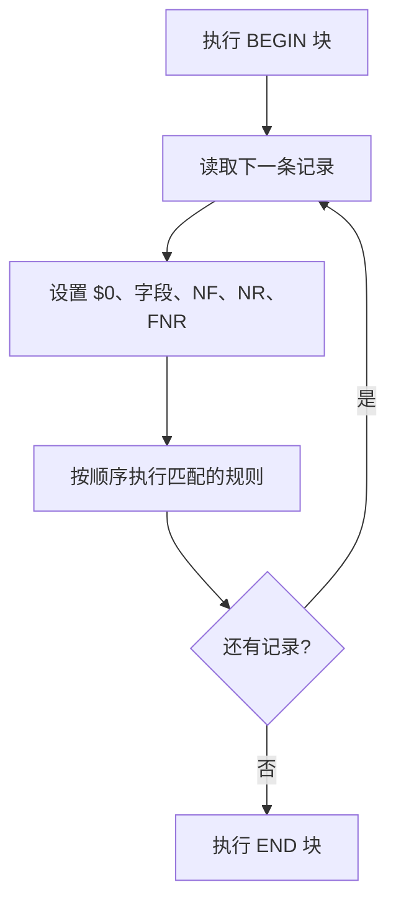

## awk 的工作模型

awk 的核心只有一句话：**按记录读取输入，把记录拆成字段，再对每条记录执行匹配的规则**。这句话听起来简单，但它决定了 awk 的大部分行为：为什么 `$1` 是第一列，为什么 `NR` 会递增，为什么修改一个字段会影响 `$0`，以及为什么 `END` 能拿到最后的总数。

这一篇先建立这个模型。后面讲字段、模式、数组和函数，都是在这个模型上加细节。

### 一条记录发生了什么

假设输入是：

```shell
Alice Engineering 120000
```

执行：

```shell
$ printf 'Alice Engineering 120000\n' | awk '{ print NR "|" NF "|" $0 "|" $1 "|" $NF }'
1|3|Alice Engineering 120000|Alice|120000
```

awk 做了这些事：

- 从输入读入一行，把它当作一条**记录**(record)，放进 `$0`。
- 按默认的字段分隔符（空白）把记录拆成 3 个**字段**(field)：`$1` 是 `Alice`，`$2` 是 `Engineering`，`$3` 是 `120000`。
- 把字段数写入 `NF`，当前记录号写入 `NR`。
- 执行动作 `{ print ... }`，把结果写到标准输出。
- 读下一行，重复上面的过程。

`$0` 是整条记录，`$1`、`$2`、`$3` 是字段。字段编号从 1 开始，没有 `$0` 之外的“第 0 个字段”。

### 主循环

awk 程序不是从头到尾执行一遍就结束，而是有一个隐含的主循环：



这张图只画主路径，省略了 `next`、`nextfile` 和 `exit` 改变流程的情况；这些会在[模式与动作](patterns-actions.md)和[控制流与函数](control-flow.md)里补上。

三个关键结论：

- `BEGIN` 块在读取任何记录之前执行，适合初始化变量、打印表头。
- 普通规则对每条记录执行一次，只有模式匹配时才执行动作。
- `END` 块在所有记录处理完后执行，适合输出汇总。

如果程序只有 `BEGIN` 块，awk 不会等待标准输入，直接执行完就退出。

### 程序由规则组成

一个 awk 程序由若干条规则组成，每条规则的基本形式是：

```awk
pattern { action }
```

- **模式**(pattern)决定这条规则对哪些记录生效。
- **动作**(action)是匹配时执行的一组语句。

模式和动作都可以省略，含义不同：

| 写法 | 含义 |
| --- | --- |
| `pattern { action }` | 模式匹配时执行动作 |
| `pattern` | 模式匹配时打印 `$0` |
| `{ action }` | 对每条记录都执行动作 |
| `pattern { }` | 匹配时什么也不做，常配合 `next` 使用 |

例如，打印所有含 `Engineering` 的行：

```shell
$ awk '/Engineering/' examples/data/employees.tsv
1	Alice	Engineering	120000	Beijing
3	Carol	Engineering	135000	Shenzhen
6	Frank	Engineering	110000	Beijing
12	Lisa	Engineering	128000	Shenzhen
```

`/Engineering/` 是一个正则模式，省略动作时默认打印 `$0`。

打印薪资大于 100000 的员工：

```shell
$ awk -F '\t' 'NR > 1 && $4 > 100000 { print $2, $4 }' examples/data/employees.tsv
Alice 120000
Carol 135000
Frank 110000
Lisa 128000
```

这里的模式是 `NR > 1 && $4 > 100000`，动作是 `{ print $2, $4 }`。`NR > 1` 用来跳过表头，原因见下面的“常见误区”。

### BEGIN 与 END

`BEGIN` 和 `END` 是两条特殊规则，它们不对应任何输入记录：

```shell
$ awk -F '\t' '
BEGIN { print "name", "salary" }
NR > 1 { print $2, $4; total += $4 }
END   { print "total", total }
' examples/data/employees.tsv
name salary
Alice 120000
Bob 90000
Carol 135000
Dave 70000
Eve 95000
Frank 110000
Grace 68000
Heidi 88000
Ivan 92000
Judy 99000
Ken 72000
Lisa 128000
total 1167000
```

执行顺序：

- `BEGIN` 打印表头，此时还没有读任何记录。
- 对每条记录，`NR > 1` 为真时打印姓名和薪资，并把薪资累加到 `total`。
- 所有记录读完后，`END` 打印总数。

`total` 没有在 `BEGIN` 里初始化，但 awk 的未初始化变量既是空字符串也是数字 0，所以 `total += $4` 第一次执行时相当于 `0 + 120000`。这一点在[变量与表达式](expressions-variables.md)里详细解释。

### 字段与 $0 的关系

`$0` 是整条记录，字段是它的拆分结果。修改字段会**重建** `$0`：

```shell
$ printf '1\tAlice\tEngineering\t120000\tBeijing\n' | awk -F '\t' '
BEGIN { OFS = "|" }
{
  print "before: [" $0 "]"
  $2 = "A. Chen"
  print "after:  [" $0 "]"
  print "NF=" NF
  print "$2=" $2
}
'
before: [1	Alice	Engineering	120000	Beijing]
after:  [1|A. Chen|Engineering|120000|Beijing]
NF=5
$2=A. Chen
```

发生了两件事：

- 给 `$2` 赋值后，awk 用 `OFS` 把 `$1` 到 `$NF` 重新连接成新的 `$0`。原来的制表符变成了 `|`。
- `NF` 仍然是 5，字段数没有变，只是第二个字段的值变了。

如果直接给 `$0` 赋值，awk 会按 `FS` 重新拆分字段：

```shell
$ printf 'a b c\n' | awk '{ $0 = "x:y"; print NF, "[" $1 "]" }'
1 [x:y]
```

默认 `FS` 是空白，`x:y` 里没有空白，所以整条记录只有一个字段。这个区别在[字段与记录](fields-records.md)里会展开。

### print 的三种常见写法

```shell
$ printf 'Alice 120000\n' | awk '{ print $1, $2; print $1 $2; print $1 " " $2 }'
Alice 120000
Alice120000
Alice 120000
```

- `print $1, $2`：逗号分隔，输出时用 `OFS` 连接，默认是一个空格。
- `print $1 $2`：两个表达式直接相邻，表示字符串拼接，中间没有分隔符。
- `print $1 " " $2`：显式拼接一个空格字符串。

`print` 默认在末尾追加 `ORS`，默认是换行。`printf` 不会自动换行，需要自己写 `\n`。例如把总数格式化成两位小数：

```shell
$ awk -F '\t' 'NR > 1 { total += $4 } END { printf "total=%.2f\n", total }' examples/data/employees.tsv
total=1167000.00
```

这里先用 `printf` 控制小数位，完整的格式规则在[格式化输出](printf-output.md)里讲。

### 多条规则按顺序执行

同一条记录会依次经过程序里的每条规则，除非某条规则用 `next` 提前结束：

```shell
$ awk -F '\t' '
NR > 1 { print "row", $2 }
NR > 1 && $4 > 100000 { print "high", $2 }
' examples/data/employees.tsv | head -n 6
row Alice
high Alice
row Bob
row Carol
high Carol
row Dave
```

第一条规则对所有数据行打印 `row`，第二条只对高薪行打印 `high`。两条规则都会执行，所以 Alice 和 Carol 各出现两次。

如果只想让高薪行走一条完全不同的处理路径，可以在第一条规则里用 `next`：

```shell
$ awk -F '\t' '
NR == 1 { next }
$4 > 100000 { print "high", $2; next }
{ print "normal", $2 }
' examples/data/employees.tsv | head -n 5
high Alice
normal Bob
high Carol
normal Dave
normal Eve
```

`next` 让当前记录跳过后面所有规则，直接开始下一条记录。它和循环里的 `continue` 不同：`next` 作用于记录，不是循环迭代。

### 程序的写法

短程序可以直接写在命令行：

```shell
awk -F '\t' 'NR > 1 { print $2 }' examples/data/employees.tsv
```

长程序写成文件更清楚：

```awk
# examples/scripts/salary-sum.awk
BEGIN { FS = "\t" }
NR > 1 { total += $4 }
END    { printf "total=%d\n", total }
```

运行：

```shell
awk -f examples/scripts/salary-sum.awk examples/data/employees.tsv
```

规则可以写在同一行，用分号分隔：

```shell
awk 'BEGIN { FS = "\t" }; NR > 1 { print $2 }' examples/data/employees.tsv
```

也可以跨多行写。awk 不要求每条规则占一行，但**可读性优先**：初始化、数据处理、汇总各占一段，通常比压成一行更容易维护。

注释以 `#` 开头，可以单独一行，也可以放在语句末尾：

```awk
# 只处理数据行
NR > 1 { print $2 }   # 姓名
```

### 常见误区

| 误区 | 实际行为 | 怎么核对 |
| --- | --- | --- |
| `$1` 是 shell 的第一个参数 | awk 程序里的 `$1` 是当前记录的第一个字段 | 用单引号包住程序，打印 `$1` 和 `$0` 对照 |
| `print $1 $2` 会加空格 | 相邻表达式是字符串拼接，中间没有分隔符 | 改成 `print $1, $2` 或显式拼接 `" "` |
| 修改 `$2` 只改变量，不影响 `$0` | 修改字段会用 `OFS` 重建 `$0` | 修改前后各打印一次 `$0` |
| `$4 > 100000` 一定不会匹配表头 | 表头的 `$4` 是字符串 `salary`，字符串和数字比较时可能按字符串规则，结果可能为真 | 加 `NR > 1`，或用 `$4 + 0 > 100000` |
| `NR` 从 0 开始 | `NR` 从 1 开始，`FNR` 也是 | 打印第一条记录的 `NR` |
| 不给文件名就会读标准输入 | 没有文件参数时 awk 读标准输入；只有 `BEGIN` 时不会等待输入 | 用 <code>printf ... &#124; awk ...</code> 或显式给文件 |

表头那条值得展开。`examples/data/employees.tsv` 的第一行是：

```shell
id	name	dept	salary	city
```

`$4` 是 `salary`。在 awk 的比较规则里，字符串和数字比较时不一定把字符串转成 0；GNU awk 在这里按字符串比较，`"salary" > "100000"` 为真，所以表头会意外匹配。**处理带表头的文件时，显式写 `NR > 1` 或 `FNR > 1`**，不要依赖“字符串转数字一定失败”。

### 小结

- awk 按记录读取，默认一条记录是一行；记录被拆成字段。
- 程序由模式-动作规则组成，`BEGIN` 和 `END` 是特殊规则。
- `$0` 是整条记录，`$1` 起是字段，`NF` 是字段数，`NR` 是记录号。
- 修改字段会重建 `$0`，重建时使用 `OFS`。
- `print` 用逗号分隔时使用 `OFS`，相邻表达式直接拼接。
- 同一条记录会按顺序经过所有匹配的规则，`next` 可以提前跳过。

### 练习

- 打印 `examples/data/employees.tsv` 中每行的 `NR`、`NF` 和 `$0`，观察表头和数据行的 `NF` 是否相同。
- 只打印 `Engineering` 部门的姓名和薪资，跳过表头。
- 用 `BEGIN` 打印表头 `name city`，用普通规则打印姓名和城市，用 `END` 打印 `done`。
- 修改第二列的值为 `X`，同时设置 `OFS="|"`，观察 `$0` 的变化。
- 解释为什么 `awk -F '\t' '$4 > 100000 { print $2 }' examples/data/employees.tsv` 可能把表头也打印出来。

<details>
<summary>参考答案</summary>

打印记录信息：

```shell
awk -F '\t' '{ print NR, NF, $0 }' examples/data/employees.tsv
```

表头和数据行都有 5 个字段，所以 `NF` 都是 5。

按部门筛选：

```shell
awk -F '\t' 'NR > 1 && $3 == "Engineering" { print $2, $4 }' examples/data/employees.tsv
```

三段式输出：

```shell
awk -F '\t' '
BEGIN { print "name", "city" }
NR > 1 { print $2, $5 }
END { print "done" }
' examples/data/employees.tsv
```

修改第二列：

```shell
printf '1\tAlice\tEngineering\t120000\tBeijing\n' | awk -F '\t' 'BEGIN { OFS = "|" } { $2 = "X"; print }'
```

输出 `1|X|Engineering|120000|Beijing`。字段被修改后，awk 用 `OFS` 重建了 `$0`。

表头问题：表头的 `$4` 是字符串 `salary`，和数字 `100000` 比较时按字符串规则处理，`"salary"` 的排序在 `"100000"` 之后，条件为真。加 `NR > 1` 可以排除表头，或者写 `$4 + 0 > 100000` 强制按数字比较。

</details>
